<section class="cover">
<div class="cover-school">ESGI - AL5 / T1</div>
<div class="cover-main">
<div class="cover-course">Apprentissage<br>par renforcement</div>
<div class="cover-title">TP MDP : Snake</div>
<div class="cover-subtitle">Processus de décision markoviens et Q-Learning</div>
<div class="cover-scope">Rapport final - Exercices 1 à 4, bonus inclus</div>
</div>
<div class="cover-authors">
RUSESCU Daniel Alexandru<br>
BAH Sulaiman<br>
SEDJAI Fethi
</div>
<div class="cover-meta">
Enseignant : Sylvain Gault<br>
Date : {{DATE}}
</div>
<div class="cover-work">
<div class="cover-work-title">Répartition du travail</div>
<p>Toutes les parties ont été réalisées ensemble par les trois membres du groupe : conception, code,
tests, graphiques, analyse, rédaction et relecture. La mention « Travail collectif » associée à
chaque question renvoie à cette répartition commune.</p>
<p class="cover-repo">Code source : dépôt GitHub du groupe - <a href="https://github.com/Sulaimanzy/mdp-snake-alex-sulaiman-fethi">github.com/Sulaimanzy/mdp-snake-alex-sulaiman-fethi</a></p>
</div>
</section>

<div class="toc-title">Sommaire</div>

[TOC]

## Reproduction des résultats

- Python 3.9 au minimum, version exigée par `matplotlib` 3.8. Le projet a été développé
  et testé avec Python 3.14 sous Windows. Le jeu et le modèle MDP n'ont besoin
  d'aucune dépendance ; `numpy` sert aux expériences et aux tests, `matplotlib` aux
  figures, `markdown`, `pygments` et `pymupdf` à générer ce rapport.
- Installation dans un environnement virtuel, depuis la racine du dépôt :

```text
Windows (PowerShell)
  py -m venv .venv
  Set-ExecutionPolicy -Scope Process -ExecutionPolicy Bypass
  .venv\Scripts\Activate.ps1
  python -m pip install -r requirements.txt

macOS / Linux
  python3 -m venv .venv
  source .venv/bin/activate
  python -m pip install -r requirements.txt
```

Sous Windows, `python -m venv .venv` remplace la première ligne si le lanceur `py` est
absent. `Set-ExecutionPolicy` n'autorise l'activation que pour la fenêtre en cours ; dans
l'invite de commandes (cmd), on active avec `.venv\Scripts\activate.bat`. Sous Debian ou
Ubuntu, il faut d'abord installer le paquet `python3-venv`.

- Une fois l'environnement activé, sur tous les systèmes :

```bash
python -m unittest discover tests      # tests (jeu, modèle MDP, joueur, statistiques)
python ex1_demo.py                     # exercice 1 : partie scriptée
python ex1_demo.py --play              # exercice 1 : jouer au clavier (z q s d + Entrée)
python ex2_mdp.py                      # exercice 2 : réponses calculées + figure du MDP
python ex3_qlearning.py play           # exercice 3 : l'IA apprend puis on la regarde jouer
python ex3_qlearning.py all            # exercice 3 : tout (≈ 4 min sur 32 cœurs)
python ex4_long_snake.py demo          # exercice 4 : un serpent de 5 cases se mord la queue
python ex4_long_snake.py all           # exercice 4 : tout (≈ 9 min, 32 cœurs, 7 Go)
python rapport/build_pdf.py            # régénère ce rapport en PDF
```

- La génération du PDF imprime la page avec Edge, Chrome ou Chromium, cherchés aux
  emplacements habituels sous Windows, macOS et Linux. Un autre navigateur peut être
  indiqué dans la variable d'environnement `PDF_BROWSER`
  (PowerShell : `$env:PDF_BROWSER = "C:\chemin\vers\chrome.exe"` ;
  cmd : `set PDF_BROWSER=C:\chemin\vers\chrome.exe` ;
  bash : `export PDF_BROWSER="/chemin/vers/chrome"`).

Les expériences de l'exercice 3 peuvent aussi être lancées une à une
(`q10`, `q11`, `q12`, `q13`, `q14`, `long`). Toutes les graines aléatoires sont fixées :
la partie `i` utilise la graine `i` pour le jeu et `1 000 000 + i` pour le joueur, quel que
soit γ. Les résultats sont donc reproductibles à l'identique.

Fichiers :

| Fichier | Contenu |
|---|---|
| `snake.py` | classe `ShortSnake` (mécanique du jeu) |
| `ex1_demo.py` | démonstration de l'exercice 1 |
| `mdp.py` | modèle MDP du jeu : états, actions, dynamique p(s′, r \| s, a) |
| `ex2_mdp.py` | réponses de l'exercice 2 et figure `rapport/figures/ex2_mdp.png` |
| `greedy_player.py` | joueur Q-Learning ε-greedy (repris du TP Bandit manchot) |
| `ex3_qlearning.py` | programme principal et expériences de l'exercice 3 |
| `ex4_long_snake.py` | expériences de l'exercice 4 (serpent plus long) |
| `resultats/*.csv` | résultats chiffrés des expériences des exercices 3 et 4 |
| `tests/test_snake.py` | tests unitaires de `ShortSnake` |
| `tests/test_mdp.py` | tests du modèle MDP (comptages, probabilités, cohérence avec le jeu) |
| `tests/test_qlearning.py` | tests de `save_state`/`restore_state`, du joueur et du programme principal |
| `tests/test_long_snake.py` | tests du serpent de plusieurs cases (jeu, modèle, comptage, joueur) |
| `rapport/rapport.md` | source de ce rapport |
| `rapport/build_pdf.py` | conversion du rapport en PDF (Markdown → HTML → PDF via Edge, Chrome ou Chromium) |

---

## Exercice 1 - Jeu de base

Convention : les coordonnées sont des tuples `(ligne, colonne)`, `(0, 0)` étant le
coin en haut à gauche. Les directions sont les chaînes `UP`, `DOWN`, `LEFT`, `RIGHT`.

La classe a ensuite été étendue à l'exercice 4 (serpent de plusieurs cases). Les
extraits ci-dessous sont ceux du code final ; les ajouts de l'exercice 4 sont signalés
en commentaire et n'interviennent pas pour un serpent d'une case.

```python
EMPTY, SNAKE, FRUIT = 0, 1, 2

UP, DOWN, LEFT, RIGHT = "UP", "DOWN", "LEFT", "RIGHT"
DIRECTIONS = {UP: (-1, 0), DOWN: (1, 0), LEFT: (0, -1), RIGHT: (0, 1)}
OPPOSITE = {UP: DOWN, DOWN: UP, LEFT: RIGHT, RIGHT: LEFT}

WALL_PENALTY = -10
FRUIT_REWARD = 10
```

### Question 1.1 - Classe `ShortSnake` et grille

*Travail collectif*

```python
class ShortSnake:
    def __init__(self, size=10, seed=None, length=1):
        if isinstance(size, int):
            size = (size, size)
        self.n_rows, self.n_cols = size
        if self.n_rows < 1 or self.n_cols < 1 or self.n_rows * self.n_cols < 2:
            raise ValueError("la grille doit contenir au moins 2 cases")
        ...   # longueur du serpent (exercice 4)
        self.grid = [[EMPTY] * self.n_cols for _ in range(self.n_rows)]
        self.rng = random.Random(seed)
```

La taille est un entier (grille carrée) ou un couple `(lignes, colonnes)`. La grille
est une liste de listes dont chaque case vaut `EMPTY`, `SNAKE` ou `FRUIT`. Il faut au
moins 2 cases pour pouvoir placer le serpent et le fruit. Le générateur `rng` peut
recevoir une graine pour rendre une partie reproductible.

### Question 1.2 - Position et direction initiales

*Travail collectif*

```python
        self.snake_pos = (self.n_rows // 2, self.n_cols // 2)
        self.snake_dir = RIGHT
        self._set_cell(self.snake_pos, SNAKE)

    def _set_cell(self, pos, value):
        row, col = pos
        self.grid[row][col] = value
```

Le serpent démarre au milieu de la grille (`(5, 5)` pour une grille 10 × 10) et part
vers la droite.

### Question 1.3 - Position aléatoire du fruit

*Travail collectif*

```python
        self.fruit_pos = self._place_fruit()

    def _place_fruit(self):
        free_cells = [
            (row, col)
            for row in range(self.n_rows)
            for col in range(self.n_cols)
            if self.grid[row][col] == EMPTY
        ]
        pos = self.rng.choice(free_cells)
        self._set_cell(pos, FRUIT)
        return pos
```

Le fruit est tiré uniformément parmi les cases libres, il n'apparaît donc jamais sous
le serpent.

### Question 1.4 - Score

*Travail collectif*

```python
        self.score = 0
```

### Question 1.5 - Méthode `move`

*Travail collectif*

```python
    def move(self, direction=None):
        if direction is not None:
            if direction not in DIRECTIONS:
                raise ValueError(f"direction inconnue : {direction!r}")
            if direction != OPPOSITE[self.snake_dir]:
                self.snake_dir = direction

        d_row, d_col = DIRECTIONS[self.snake_dir]
        row, col = self.snake_pos[0] + d_row, self.snake_pos[1] + d_col
        reward = 0
        ...   # bord franchi (question 1.6)

        new_head = (row, col)
        if self.body:
            ...   # le corps suit la tête (exercice 4)
        else:
            self._set_cell(self.snake_pos, EMPTY)
        self.snake_pos = new_head
        self._set_cell(self.snake_pos, SNAKE)
        ...   # fruit mangé (question 1.7)
        self.score += reward
        return reward
```

`None` garde la direction courante. Une demande de demi-tour est ignorée : le
serpent continue dans sa direction actuelle. La méthode renvoie la récompense de
l'étape, qui servira au Q-Learning (exercice 3).

### Question 1.6 - Franchissement d'un bord

*Travail collectif*

```python
        if not (0 <= row < self.n_rows and 0 <= col < self.n_cols):
            row %= self.n_rows
            col %= self.n_cols
            reward += WALL_PENALTY
```

Le modulo fait réapparaître le serpent du côté opposé (ligne `-1` → ligne `n_rows - 1`,
colonne `n_cols` → colonne `0`), avec une pénalité de 10 points.

### Question 1.7 - Fruit mangé

*Travail collectif*

```python
        if self.snake_pos == self.fruit_pos:
            reward += FRUIT_REWARD
            self.fruit_pos = self._place_fruit()
```

Le test a lieu après le déplacement de la tête : la case du fruit est déjà marquée
`SNAKE`, donc le nouveau fruit est tiré parmi les autres cases. Si le serpent
franchit un bord et tombe sur le fruit, les deux récompenses s'additionnent
(−10 + 10 = 0).

### Question 1.8 - Affichage `__str__`

*Travail collectif*

```python
HEAD_SYMBOL = {UP: "^", DOWN: "v", LEFT: "<", RIGHT: ">"}
BODY_SYMBOL = "o"   # exercice 4
CELL_SYMBOL = {EMPTY: ".", FRUIT: "*"}

    def __str__(self):
        border = "+" + "-" * self.n_cols + "+"
        lines = [border]
        for r, row in enumerate(self.grid):
            cells = (
                (HEAD_SYMBOL[self.snake_dir] if (r, c) == self.snake_pos else BODY_SYMBOL)
                if cell == SNAKE else CELL_SYMBOL[cell]
                for c, cell in enumerate(row)
            )
            lines.append("|" + "".join(cells) + "|")
        lines.append(border)
        lines.append(f"Score : {self.score}")
        return "\n".join(lines)
```

La tête est dessinée par une flèche qui indique sa direction. Extrait de
`python ex1_demo.py` (grille 5 × 8, graine 42) :

```text
Étape 5 : move(UP) -> récompense +10 (on mange le fruit : +10)
+--------+
|.*.....^|
|........|
|........|
|........|
|........|
+--------+
Score : 10

Étape 6 : move(UP) -> récompense -10 (bord du haut franchi : on réapparaît en bas, -10)
+--------+
|.*......|
|........|
|........|
|........|
|.......^|
+--------+
Score : 0
```

Les 17 tests de `tests/test_snake.py` vérifient chacun de ces comportements
(position initiale, demi-tour ignoré, passage des quatre bords, fruit mangé, cohérence
de la grille, affichage).

---

## Exercice 2 - Modélisation du MDP

Le modèle est codé dans `mdp.py` ; `ex2_mdp.py` en déduit les réponses. Sortie de
`python ex2_mdp.py` :

```text
Q2.1  état = (tête, direction, fruit) = ((5, 5), 'RIGHT', (4, 9))
Q2.2  grille 10 x 10 : 39600 états (énumérés : 39600, atteignables : 39600)
Q2.3  |S| = 4·N·M·(N·M − 1) : {'3x3': 288, '4x5': 1520, '10x10': 39600, '20x20': 638400}
Q2.4  arguments de move : [None, 'UP', 'DOWN', 'LEFT', 'RIGHT']
      actions regroupées par effet dans ((5, 5), 'RIGHT', (4, 9)) : [[None, 'LEFT', 'RIGHT'], ['UP'], ['DOWN']]
Q2.5  A(s) si direction = UP    : ['UP', 'LEFT', 'RIGHT']
Q2.5  A(s) si direction = DOWN  : ['DOWN', 'LEFT', 'RIGHT']
Q2.5  A(s) si direction = LEFT  : ['UP', 'DOWN', 'LEFT']
Q2.5  A(s) si direction = RIGHT : ['UP', 'DOWN', 'RIGHT']
Q2.6  récompenses possibles : [-10, 0, 10]
      exemple bord  : [(1.0, ((5, 0), 'RIGHT', (0, 0)), -10)]
      exemple fruit : 99 états suivants, p = 1/99, r = 10
```

### Question 2.1 - Informations constituant un état

*Travail collectif*

```python
def state_of(game):
    """État du MDP pour une partie en cours : (tête, direction, fruit), plus le corps pour
    un serpent de plusieurs cases."""
    if getattr(game, "body", None):   # serpent de plusieurs cases (exercice 4)
        return game.save_state()
    return (game.snake_pos, game.snake_dir, game.fruit_pos)
```

Un état contient tout ce qui détermine la suite du jeu (propriété de Markov) :

- la **position de la tête** `(ligne, colonne)` ;
- la **direction courante** : elle fixe l'effet de `None` (continuer tout droit) et le
  demi-tour interdit. Sans elle, la transition dépendrait des coups précédents ;
- la **position du fruit**, qui fixe la récompense des prochains déplacements.

Le score n'en fait pas partie : c'est la somme des récompenses déjà reçues, il
n'influence pas la suite du jeu et rendrait l'ensemble des états infini. La grille non
plus : elle se déduit de la tête et du fruit.

### Question 2.2 - Nombre d'états pour une grille 10 × 10

*Travail collectif*

```python
def n_states(n_rows, n_cols):
    """|S| = N·M positions de tête × 4 directions × (N·M − 1) positions du fruit."""
    n_cells = n_rows * n_cols
    return n_cells * len(DIRECTIONS) * (n_cells - 1)


def all_states(size):
    """Énumère tous les états : le fruit n'est jamais sous la tête."""
    grid_cells = cells(size)
    return [
        (head, direction, fruit)
        for head in grid_cells
        for direction in DIRECTIONS
        for fruit in grid_cells
        if fruit != head
    ]
```

**100 × 4 × 99 = 39 600 états.** Le fruit n'est jamais sur la tête : dès que le serpent
l'atteint, il est mangé et replacé sur une autre case. Le dénombrement est confirmé par
l'énumération, et un parcours en largeur du graphe du MDP (`reachable_states`) montre
que les 39 600 états sont tous atteignables depuis l'état initial.

### Question 2.3 - Grille N × M

*Travail collectif*

Même fonction `n_states(n_rows, n_cols)` :

**|S| = 4 · N · M · (N · M − 1)**

| Grille | 3 × 3 | 4 × 5 | 10 × 10 | 20 × 20 |
|---|---|---|---|---|
| États | 288 | 1 520 | 39 600 | 638 400 |

Le nombre d'états croît comme le carré du nombre de cases. Le test `test_count_formula`
vérifie la formule par énumération sur plusieurs tailles.

### Question 2.4 - Actions du MDP

*Travail collectif*

```python
MOVE_ARGUMENTS = [None, UP, DOWN, LEFT, RIGHT]   # arguments acceptés par move

_LEGAL_ACTIONS = {
    direction: [d for d in DIRECTIONS if d != OPPOSITE[direction]]
    for direction in DIRECTIONS
}


def actions(state):
    """A(s) : les quatre directions sauf le demi-tour (None équivaut à la direction courante)."""
    return _LEGAL_ACTIONS[state[1]]
```

Les listes sont calculées une seule fois par direction, car `actions` est appelée
plusieurs fois à chaque étape du Q-Learning (exercice 3).

`move` accepte cinq arguments, mais ils n'ont que **trois effets distincts** : continuer
tout droit, tourner à gauche, tourner à droite. Dans l'état `((5, 5), RIGHT, …)`, `None`,
`LEFT` (demi-tour ignoré) et `RIGHT` mènent au même état. On retient donc comme actions
du MDP les trois directions qui ne sont pas un demi-tour.

### Question 2.5 - Les actions dépendent-elles de l'état ?

*Travail collectif*

```python
for direction in (UP, DOWN, LEFT, RIGHT):
    print(f"A(s) si direction = {direction:5} :", actions(((5, 5), direction, (0, 0))))
```

**Oui** : 𝒜(s) = {UP, DOWN, LEFT, RIGHT} \ {opposé de la direction de s}. Seule la
direction de l'état intervient, pas la position de la tête ni celle du fruit. On aurait pu
modéliser des actions relatives (tout droit, gauche, droite), identiques dans tous les
états ; leur effet absolu dépendrait alors de la direction. Nous gardons les directions
absolues, qui correspondent directement aux arguments de `move`.

### Question 2.6 - Récompenses du MDP

*Travail collectif*

```python
def transitions(state, action, size):
    """p(s', r | s, a) sous forme de liste de (probabilité, état suivant, récompense)."""
    n_rows, n_cols = _size(size)
    (row, col), direction, fruit = state

    if action is not None and action != OPPOSITE[direction]:
        direction = action
    d_row, d_col = DIRECTIONS[direction]
    row, col = row + d_row, col + d_col

    reward = 0
    if not (0 <= row < n_rows and 0 <= col < n_cols):
        row, col = row % n_rows, col % n_cols
        reward += WALL_PENALTY
    head = (row, col)

    if head != fruit:  # déplacement déterministe
        return [(1.0, (head, direction, fruit), reward)]

    # Fruit mangé : le nouveau fruit est uniforme sur les N·M − 1 autres cases
    reward += FRUIT_REWARD
    free_cells = [cell for cell in cells(size) if cell != head]
    prob = 1 / len(free_cells)
    return [(prob, (head, direction, new_fruit), reward) for new_fruit in free_cells]
```

**ℛ = {−10, 0, +10}** :

| Situation | Récompense |
|---|---|
| fruit mangé | +10 |
| bord franchi | −10 |
| bord franchi et fruit mangé au même pas | −10 + 10 = 0 |
| autre déplacement | 0 |

La fonction donne la dynamique complète p(s′, r | s, a) du cours. Le déplacement est
déterministe ; seul le placement du nouveau fruit est aléatoire, avec une probabilité
1 / (N·M − 1) pour chaque case libre. Il n'y a pas d'état final : c'est une tâche
continue. Le test `test_model_matches_game` joue 2 000 coups aléatoires avec
`ShortSnake` et vérifie que chaque résultat du jeu est bien prévu par `transitions`.

### Question 2.7 - Représentation graphique du MDP

*Travail collectif*

```python
def draw_mdp_figure(path):
    size = (3, 3)

    # États du cycle, obtenus avec le modèle p(s', r | s, a)
    A = ((1, 0), RIGHT, (0, 0))
    [(p_ab, B, r_ab)] = transitions(A, RIGHT, size)
    [(p_bc, C, r_bc)] = transitions(B, RIGHT, size)
    [(p_ca, back, r_ca)] = transitions(C, RIGHT, size)
    assert back == A, "RIGHT trois fois depuis A doit revenir en A"
    [(p_ad, D, r_ad)] = transitions(A, DOWN, size)
    eaten = transitions(A, UP, size)  # fruit mangé : 8 états suivants
    ...  # dessin avec matplotlib (mini-grilles, points d'action, flèches « p, r »)
```

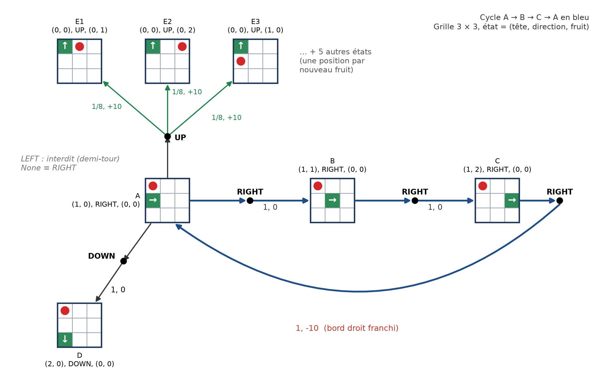

La figure reprend la notation du cours (robot aspirateur) sur une grille 3 × 3 :
chaque état est dessiné par sa mini-grille (tête verte fléchée, fruit rouge), chaque point
noir est une action, chaque flèche porte « probabilité, récompense ».

- **Cycle A → B → C → A** (en bleu) : en répétant `RIGHT` sur la ligne du milieu, le
  serpent traverse le bord droit et revient en A. Les récompenses du cycle sont 0, 0 et
  −10.
- **Action UP depuis A** : la tête arrive sur le fruit (+10) ; le nouveau fruit est tiré parmi les
  8 autres cases, d'où 8 états suivants de probabilité 1/8 (3 sont dessinés).
- **Action DOWN depuis A (vers D)** : déplacement déterministe sans récompense.
- **LEFT** est un demi-tour depuis A : il n'est pas dans 𝒜(A), et `None` équivaut à
  `RIGHT`. Pour B et C, seule l'action du cycle est représentée.

---

## Exercice 3 - Implémentation du Q-Learning

### Question 3.1 - Méthode `save_state`

*Travail collectif*

```python
    def save_state(self):
        """Renvoie l'état actuel du jeu : (tête, direction, fruit), plus le corps
        (tuple des cases, du cou à la queue) pour un serpent de longueur ≥ 2.

        C'est l'état du MDP (exercice 2) : le score n'en fait pas partie, c'est la
        somme des récompenses déjà reçues.
        """
        if self.body:   # (exercice 4)
            return (self.snake_pos, self.snake_dir, self.fruit_pos, tuple(self.body))
        return (self.snake_pos, self.snake_dir, self.fruit_pos)
```

Le tuple contient exactement l'état du MDP de la question 2.1. Il est hachable, ce qui
permet de l'utiliser directement comme clé du tableau Q. Y ajouter le score rendrait
chaque état unique : l'agent ne reverrait jamais deux fois le même état et ne pourrait
rien apprendre.

### Question 3.2 - Méthode `restore_state`

*Travail collectif*

```python
    def _as_cell(self, pos):
        """Convertit `pos` en tuple (ligne, colonne) d'entiers dans la grille."""
        try:
            row, col = (operator.index(x) for x in pos)
        except (TypeError, ValueError):
            raise ValueError(f"case invalide : {pos!r}") from None
        if not (0 <= row < self.n_rows and 0 <= col < self.n_cols):
            raise ValueError(f"case hors de la grille : {(row, col)}")
        return (row, col)

    def restore_state(self, state):
        """Remet le jeu dans un état renvoyé par save_state (le score est inchangé).

        Toutes les vérifications ont lieu avant la moindre modification du jeu.
        """
        try:
            if self.length == 1:
                head, direction, fruit = state
                body = ()
            else:   # serpent de plusieurs cases (exercice 4)
                head, direction, fruit, body = state
                body = tuple(body)
        except (TypeError, ValueError):
            raise ValueError(f"état invalide : {state!r}") from None
        head, fruit = self._as_cell(head), self._as_cell(fruit)
        body = tuple(self._as_cell(cell) for cell in body)
        if not isinstance(direction, str) or direction not in DIRECTIONS:
            raise ValueError(f"direction inconnue : {direction!r}")
        if fruit == head or fruit in body:
            raise ValueError("le fruit ne peut pas être sous le serpent")
        if self.length > 1:   # même un corps vide doit être vérifié (exercice 4)
            self._check_body(head, direction, body)

        self.grid = [[EMPTY] * self.n_cols for _ in range(self.n_rows)]
        self.snake_pos, self.snake_dir, self.fruit_pos = head, direction, fruit
        self.body = deque(body)
        for cell in (head, *body):
            self._set_cell(cell, SNAKE)
        self._set_cell(fruit, FRUIT)
```

La grille est reconstruite à partir de l'état, ce qui la garde cohérente avec
`snake_pos` et `fruit_pos`. Les positions sont converties en tuples d'entiers, pour que
l'état restauré reste hachable, et un état invalide est refusé avant toute
modification du jeu.

Le score et le générateur aléatoire ne sont pas restaurés : ils ne font pas partie de
l'état du MDP. Depuis un même état restauré, le même coup mène donc au même état
lorsqu'aucun fruit n'est mangé. Quand un fruit est mangé, le nouveau fruit est tiré au
hasard, comme le prévoit p(s′, r | s, a).

Les tests vérifient trois choses : l'aller-retour `save_state` → `restore_state`, le
rejet des états invalides sans effet sur le jeu, et qu'un coup rejoué avec la même
graine donne le même résultat. `restore_state` remplace aussi l'ancien utilitaire de
test de l'exercice 2.

### Question 3.3 - Formule de mise à jour du Q-Learning

*Travail collectif*

```python
    def reward(self, action, value):   # extrait, méthode complète à la question 3.8
        ...
        cible = value + self.gamma * meilleure_suite
        ...
        self.action_values[cle] = (
            (1 - self.alpha) * self.action_values.get(cle, 0.0) + self.alpha * cible
        )
```

<p class="formula">Q(s<sub>t</sub>, a<sub>t</sub>) ← (1 − α) · Q(s<sub>t</sub>, a<sub>t</sub>) + α · ( R<sub>t</sub> + γ · max<sub>a</sub> Q(s<sub>t+1</sub>, a) )</p>

- R<sub>t</sub> est la récompense reçue après l'action a<sub>t</sub> (notation du cours),
  s<sub>t+1</sub> l'état d'arrivée ;
- α ∈ ]0, 1] est le taux d'apprentissage, γ ∈ [0, 1] le facteur d'actualisation ;
- le maximum porte sur les actions possibles dans s<sub>t+1</sub>, sans demi-tour.

La valeur estimée est le retour actualisé G<sub>t</sub> = R<sub>t+1</sub> + γ G<sub>t+1</sub>
du cours : on remplace G<sub>t+1</sub> par la meilleure valeur connue depuis l'état
d'arrivée.

### Question 3.4 - Reprise de `GreedyPlayer` du TP précédent

*Travail collectif*

```python
class GreedyPlayer:
    """Apprend Q(état, action) par Q-Learning en jouant à ShortSnake."""

    ...   # constructeur (question 3.5)

    def get_action(self):
        """Explore avec la probabilité eps, sinon exploite les estimations."""
        self.state = self.game.save_state()
        explore = self.rng.random() < self.eps
        if explore:
            return self._random_action(self.state)
        return self._greedy_action(self.state)

    def _random_action(self, state):
        """Choisit uniformément parmi les actions possibles dans `state`."""
        return self.rng.choice(actions(state))
```

La classe garde la structure du TP Bandit manchot (`greedy_player.py`) : mêmes
méthodes, mêmes noms (`eps`, `action_values`, `eval_count`), même stratégie ε-greedy et
même départage aléatoire des égalités.

| Méthode | TP Bandit manchot | TP Snake |
|---|---|---|
| constructeur | `GreedyPlayer(n, eps)` | `GreedyPlayer(game, eps, alpha, gamma, seed)` |
| `action_values` | liste indexée par l'action | dictionnaire indexé par (état, action) |
| `get_action` | ε-greedy | ε-greedy, mémorise l'état courant |
| `_greedy_action` | `argmax` sur les actions | `argmax` sur les actions possibles dans l'état |
| `_random_action` | `randrange(n)` | tirage parmi les 3 actions possibles |
| `reward(action, value)` | moyenne incrémentale | mise à jour du Q-Learning |

Le générateur aléatoire est propre au joueur (`random.Random(seed)`), pour que chaque
partie soit reproductible.

### Question 3.5 - Constructeur avec une instance de `ShortSnake`

*Travail collectif*

```python
    def __init__(self, game, eps, alpha=0.5, gamma=0.5, seed=None):
        if not 0 <= eps <= 1:
            raise ValueError("Epsilon doit être compris entre 0 et 1.")
        if not 0 < alpha <= 1:
            raise ValueError("Alpha doit être compris dans ]0, 1].")
        if not 0 <= gamma <= 1:
            raise ValueError("Gamma doit être compris entre 0 et 1.")

        self.game = game          # instance de ShortSnake
        self.eps = eps
        self.alpha = alpha        # taux d'apprentissage
        self.gamma = gamma        # facteur d'actualisation
        self.action_values = {}   # Q[(état, action)], 0 si jamais mis à jour
        self.eval_count = {}      # nombre de mises à jour de chaque paire (état, action)
        self.rng = random.Random(seed)
        self.state = None         # état dans lequel la dernière action a été choisie
```

Le joueur lit l'état du jeu avec `game.save_state()`. Le nombre d'actions `n` du TP
précédent disparaît : les actions possibles dépendent maintenant de l'état
(question 2.5).

### Question 3.6 - Tableau Q indexé par (état, action)

*Travail collectif*

```python
        self.action_values = {}   # Q[(état, action)], 0 si jamais mis à jour   (constructeur)
        ...

    def _value(self, state, action):
        return self.action_values.get((state, action), 0.0)
```

Un dictionnaire évite de réserver d'avance les 39 600 × 3 = 118 800 paires d'une
grille 10 × 10 : seules les paires effectivement rencontrées sont stockées. Une paire
absente vaut 0, comme l'initialisation `[0.0] * n` du TP précédent.

### Question 3.7 - `_greedy_action` tient compte de l'état

*Travail collectif*

```python
    def _greedy_action(self, state):
        """Choisit une action de valeur Q(state, a) maximale, au hasard en cas d'égalité."""
        valeurs = [(action, self._value(state, action)) for action in actions(state)]
        meilleure_valeur = max(valeur for _, valeur in valeurs)
        meilleures_actions = [
            action for action, valeur in valeurs if valeur == meilleure_valeur
        ]
        return self.rng.choice(meilleures_actions)
```

Le maximum est pris sur les seules actions possibles dans l'état courant. Le test
`test_greedy_uses_current_state` vérifie qu'une grande valeur Q associée à un autre état
n'influence pas le choix.

### Question 3.8 - Mise à jour du Q-Learning dans `reward` (γ = 0,5)

*Travail collectif*

```python
    def reward(self, action, value):
        """Met à jour Q(s, a) après game.move(action), qui a rapporté `value`.

        Q(s, a) <- (1 - alpha) Q(s, a) + alpha (r + gamma max_a' Q(s', a'))
        """
        if self.state is None:
            raise RuntimeError("get_action doit être appelée avant reward.")
        if action not in actions(self.state):
            raise ValueError(f"action impossible dans l'état {self.state} : {action!r}")

        etat_suivant = self.game.save_state()
        meilleure_suite = max(self._value(etat_suivant, a) for a in actions(etat_suivant))
        cible = value + self.gamma * meilleure_suite

        cle = (self.state, action)
        self.action_values[cle] = (
            (1 - self.alpha) * self.action_values.get(cle, 0.0) + self.alpha * cible
        )
        self.eval_count[cle] = self.eval_count.get(cle, 0) + 1
        self.state = None   # une seule mise à jour par action choisie
```

La signature `reward(action, value)` est celle du TP précédent. L'état de départ s est
celui mémorisé par `get_action`, et l'état d'arrivée s′ est lu dans le jeu après
`move`. γ vaut 0,5 par défaut. Un second appel à `reward` sans nouvel appel à
`get_action` est refusé. Les tests `test_q_learning_update` et
`test_update_with_wall_penalty_and_gamma_zero` comparent le résultat à un calcul fait à
la main.

### Question 3.9 - Programme principal

*Travail collectif*

```python
SIZE = 10           # grille 10 x 10
EPS = 0.1           # probabilité d'exploration
ALPHA = 0.5         # taux d'apprentissage
...


def play(player, game, n_steps):
    """Fait jouer l'IA pendant n_steps étapes ; renvoie la récompense de chaque étape."""
    rewards = np.empty(n_steps, dtype=np.int8)
    for t in range(n_steps):
        action = player.get_action()
        value = game.move(action)
        player.reward(action, value)
        rewards[t] = value
    return rewards


def run(gamma, n_steps, seed, eps=EPS, alpha=ALPHA):
    """Une partie complète avec une IA neuve (graines fixées pour la reproductibilité)."""
    game = ShortSnake(SIZE, seed=seed)
    player = GreedyPlayer(game, eps, alpha=alpha, gamma=gamma, seed=1_000_000 + seed)
    return play(player, game, n_steps)
```

La boucle reprend celle du TP précédent : choisir une action, la jouer, transmettre la
récompense. `run_many` relance `run` sur plusieurs graines en parallèle
(`ProcessPoolExecutor`). La commande `python ex3_qlearning.py play` entraîne l'IA pendant
500 000 étapes, puis affiche quelques coups joués sans exploration :

```text
Entraînement : 500000 étapes en 3.7 s, score 103660, récompense moyenne sur les 1000 dernières étapes +0.860, 105907 paires (état, action) apprises

Étape 4 : UP -> +0             Étape 5 : RIGHT -> +0          Étape 6 : RIGHT -> +10
+----------+                   +----------+                   +----------+
|..........|                   |..........|                   |..........|
|..........|                   |..........|                   |..........|
|..........|                   |..........|                   |..........|
|.......^.*|                   |........>*|                   |.........>|
|..........|                   |..........|                   |..........|
|..........|                   |..........|                   |..........|
|..........|                   |..........|                   |.*........|
|..........|                   |..........|                   |..........|
|..........|                   |..........|                   |..........|
|..........|                   |..........|                   |..........|
+----------+                   +----------+                   +----------+
Score : 103670                 Score : 103670                 Score : 103680
```

(Les trois grilles, affichées l'une sous l'autre par le programme, sont mises côte à
côte ici.)

Les hyperparamètres restent fixes dans tout l'exercice : ε = 0,1 et α = 0,5, sur une
grille 10 × 10.

### Question 3.10 - Évolution de la récompense sur 1000 étapes

*Travail collectif*

```python
def q10(pool):
    rewards = run(0.5, 1000, seed=0)
    steps = np.arange(1, len(rewards) + 1)
    ...
    window = 50
    ax1.plot(steps[window - 1:], moving_average(rewards, window), ...)   # récompense glissante
    ...
    ax2.plot(steps, np.cumsum(rewards), ...)                             # score cumulé
    ...
```

`python ex3_qlearning.py q10` :

```text
Q3.10 : une partie de 1000 étapes, γ = 0.5
  score final -870 ; 9 étapes à +10, 96 étapes à -10
```

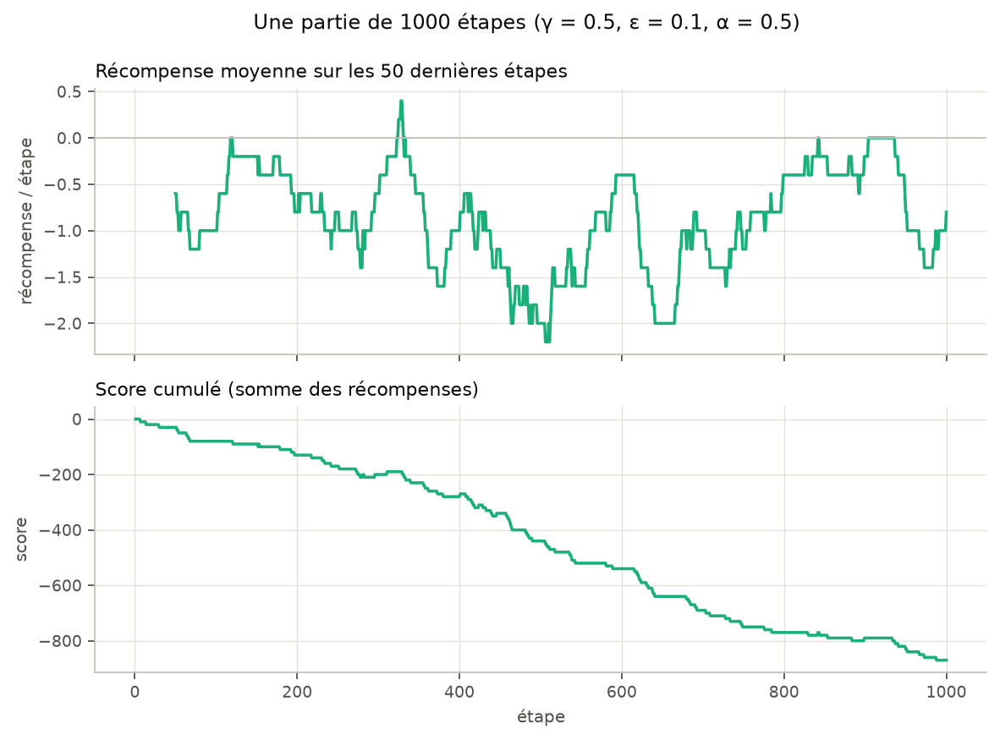

La récompense d'une étape vaut −10, 0 ou +10 : on trace sa moyenne glissante sur 50
étapes et le score cumulé. En 1000 étapes, l'IA mange 9 fruits et franchit 96 bords :
le score baisse presque linéairement, d'environ 0,9 point par étape. Sur une seule
partie, la courbe est dominée par le bruit (entre −2,2 et +0,4) et aucune tendance
n'apparaît.

### Question 3.11 - Nombre de relances pour lisser le bruit

*Travail collectif*

```python
def q11(pool):
    batch_a = run_many(pool, 0.5, 1000, 1000)                         # graines 0 à 999
    batch_b = run_many(pool, 0.5, 1000, 1000, first_seed=100_000)     # graines indépendantes
    ...
    for ax, k in zip(axes.flat, (1, 10, 100, 1000)):
        curve_a = moving_average(batch_a[:k].mean(axis=0), window)
        curve_b = moving_average(batch_b[:k].mean(axis=0), window)
        rms = float(np.sqrt(np.mean((curve_a - curve_b) ** 2)))
        mean_total, ci = total_stats(batch_a[:k])
        ...   # tableau et graphique


def mean_ci(values):
    """Moyenne et demi-largeur de l'intervalle de confiance à 95 % (loi de Student)."""
    values = np.asarray(values, dtype=float)
    if len(values) < 2:
        return values.mean(), float("nan")
    return values.mean(), t95(len(values) - 1) * values.std(ddof=1) / np.sqrt(len(values))


def total_stats(rewards):
    """Récompense totale moyenne et demi-largeur de son intervalle de confiance à 95 %."""
    return mean_ci(rewards.sum(axis=1, dtype=np.int64))
```

L'intervalle de confiance utilise le quantile de Student (`t95`, 2,26 pour 10 relances,
1,96 pour 1000) plutôt que 1,96 partout, qui serait trop optimiste avec peu de
relances.

Test retenu : on calcule deux fois la courbe moyenne avec **deux séries de relances
indépendantes**. Si le nombre de relances suffit, les deux courbes se superposent.

| Relances | Écart RMS entre les deux courbes | Récompense totale moyenne (IC 95 %) |
|---|---|---|
| 1 | 1,120 | −870 |
| 10 | 0,365 | −865,0 ± 91,4 |
| 100 | 0,120 | −834,4 ± 22,5 |
| 1000 | 0,033 | −829,5 ± 7,1 |

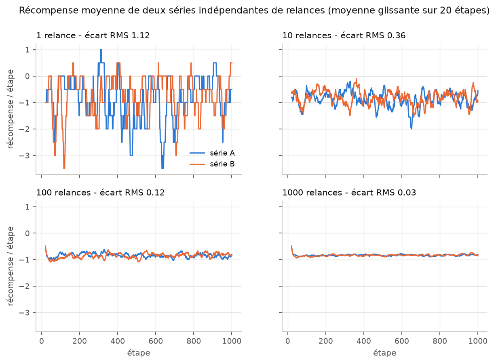

L'écart est divisé par environ 3,2 à chaque fois que le nombre de relances est
multiplié par 10 : le bruit décroît en 1/√K. **Nous retenons 1000 relances** pour les
parties de 1000 étapes : les deux courbes sont alors confondues à 0,03 près, et la
récompense totale est connue à ±7 points (±0,007 par étape). Pour les parties de
10 000 étapes, nous utilisons 500 relances afin de limiter le temps de calcul ; nous
n'y avons pas refait le test des deux séries, mais l'intervalle de confiance de la
récompense totale y est de ±0,003 par étape. Une relance coûte environ 6 µs par étape ; les relances tournent en parallèle
sur tous les cœurs.

### Question 3.12 - Comparaison de γ = 0 ; 0,1 ; 0,5 ; 0,9 et 1

*Travail collectif*

```python
def compare_gammas(pool, n_steps, n_runs, window, name, title):
    results = {gamma: run_many(pool, gamma, n_steps, n_runs) for gamma in GAMMAS}
    baseline = run_many(pool, 0.5, n_steps, n_runs, eps=1.0)       # joueur aléatoire
    for gamma, rewards in results.items():
        mean_total, ci = total_stats(rewards)
        same = identical_runs(rewards, results[0.5])
        ...   # tableau et graphique


def identical_runs(rewards, reference):
    """Nombre de parties strictement identiques (même graine) à celles de `reference`."""
    return int(np.all(rewards == reference, axis=1).sum())
```

`python ex3_qlearning.py q12` (1000 étapes, 1000 relances, mêmes graines pour chaque γ) :

| γ | Récompense totale moyenne (IC 95 %) | Parties identiques à celles de γ = 0,5 |
|---|---|---|
| 0 | −829,6 ± 7,1 | 999 / 1000 |
| 0,1 | −829,5 ± 7,1 | 1000 / 1000 |
| 0,5 | −829,5 ± 7,1 | 1000 / 1000 |
| 0,9 | −829,5 ± 7,1 | 1000 / 1000 |
| 1 | −829,5 ± 7,1 | 1000 / 1000 |
| aléatoire (ε = 1) | −894,9 ± 7,9 | - |

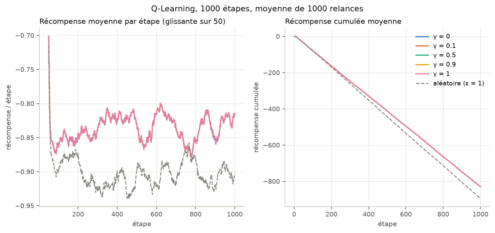

**Il n'y a pas de meilleure valeur sur 1000 étapes.** Les quatre valeurs γ > 0
produisent exactement les mêmes 1000 parties (les courbes sont superposées), et γ = 0
n'en change qu'une. En revanche, l'IA fait mieux qu'un joueur aléatoire, d'environ
65 points, quelle que soit la valeur de γ.

Pourquoi γ n'a-t-il presque aucun effet ? Une décision ne dépend que de l'**ordre** des
valeurs Q(s, a) dans l'état courant, et cet ordre ne dépend presque jamais de γ ici :

- **Chaque paire n'est presque jamais revue.** L'état contient la position du fruit, qui
  change à chaque fruit mangé. Sur une partie (graine 0), 926 paires sont mises à jour en
  1000 étapes, dont seulement 7,4 % plus d'une fois, et aucune plus de 3 fois.
  À 10 000 étapes, ce taux n'est encore que de 10,7 %.
- **γ est multiplié par une valeur nulle.** Avec Q initialisé à 0, max<sub>a</sub> Q(s′, a)
  vaut presque toujours 0 : les actions de s′ n'ont jamais été essayées, ou n'ont rien
  rapporté, et une seule action à 0 suffit, puisque les valeurs négatives ne dépassent
  pas 0. Mesuré sur la même partie : max<sub>a</sub> Q(s′, a) ≠ 0 dans 0,00 % des mises
  à jour sur 1000 étapes, 0,10 % sur 10 000 et 1,5 % sur 100 000. La cible vaut alors r
  quel que soit γ. Pour la première mise à jour d'une paire, cas de la grande majorité
  des paires, Q(s, a) vaut α·r : −5 après un bord, +5 après un fruit, 0 sinon (ou si
  les deux arrivent au même pas).
- **Le +10 ne remonte pas.** Après un fruit mangé, l'état suivant contient le nouveau
  fruit, donc des valeurs encore nulles. Les états qui menaient à l'ancien fruit ne
  sont revus que si un fruit réapparaît sur la même case.

Ces mesures sont faites par `_visit_stats` (`resultats/ex3_visites.csv`) :

```python
def _visit_stats(n_steps, gamma=0.5, seed=0):
    """Paires mises à jour, et part des mises à jour où max_a Q(s', a) ≠ 0 (seul cas où γ compte)."""
    ...
    for _ in range(n_steps):
        action = player.get_action()
        value = game.move(action)
        next_state = game.save_state()
        if max(player._value(next_state, a) for a in actions(next_state)) != 0:
            gamma_matters += 1
        player.reward(action, value)
```

Sur 1000 étapes, l'agent apprend donc seulement à ne pas refaire, dans le même état, un
coup qui lui a coûté un bord. C'est ce qui le place au-dessus du joueur aléatoire.

### Question 3.13 - Recherche de la meilleure valeur de γ

*Travail collectif*

```python
SWEEP = [round(0.05 * i, 2) for i in range(21)]   # 0, 0.05, ..., 1


def sweep(pool, n_steps, n_runs, gammas=SWEEP):
    """Balaye gamma. Comme toutes les valeurs partagent les mêmes graines, chaque valeur est
    comparée à γ = 0.5 partie par partie (écart apparié), ce qui retire le bruit commun."""
    reference = run_many(pool, 0.5, n_steps, n_runs)
    rows, means = [], {}
    for gamma in gammas:
        rewards = reference if gamma == 0.5 else run_many(pool, gamma, n_steps, n_runs)
        mean_total, ci = total_stats(rewards)
        diff, ci_diff = paired_difference(rewards, reference)
        means[gamma] = mean_total
        rows.append([gamma, n_steps, n_runs, round(float(mean_total), 1), round(float(ci), 1),
                     identical_runs(rewards, reference), round(float(diff), 2),
                     round(float(ci_diff), 2), verdict(diff, ci_diff)])
    best_mean = max(means.values())
    best = [gamma for gamma, mean in means.items() if mean == best_mean]
    ...   # affichage des résultats
    return rows, best


def paired_difference(rewards, reference):
    """Écart moyen de récompense totale avec `reference`, partie par partie (mêmes graines)."""
    return mean_ci(rewards.sum(axis=1, dtype=np.int64) - reference.sum(axis=1, dtype=np.int64))


def verdict(diff, ci):
    """Un écart est significatif si son intervalle de confiance à 95 % ne contient pas 0."""
    if diff == 0:
        return "aucun écart"
    if not np.isfinite(ci):
        return "indéterminé"
    return "significatif" if abs(diff) > ci else "non significatif"
```

`python ex3_qlearning.py q13` balaie γ de 0 à 1 par pas de 0,05, avec 1000 relances de 1000
étapes (`resultats/ex3_q13_recherche.csv`). La meilleure valeur est choisie sur les
moyennes non arrondies, et chaque γ est comparé à γ = 0,5 **partie par partie** : les
mêmes graines sont utilisées pour tous les γ, ce qui retire le bruit commun.

| γ | Récompense totale moyenne (IC 95 %) | Parties identiques à γ = 0,5 | Écart apparié avec γ = 0,5 |
|---|---|---|---|
| 0 | −829,6 ± 7,1 | 999 / 1000 | −0,13 ± 0,26 |
| 0,05 à 1 (20 valeurs) | −829,5 ± 7,1 | 1000 / 1000 | 0 (parties identiques) |

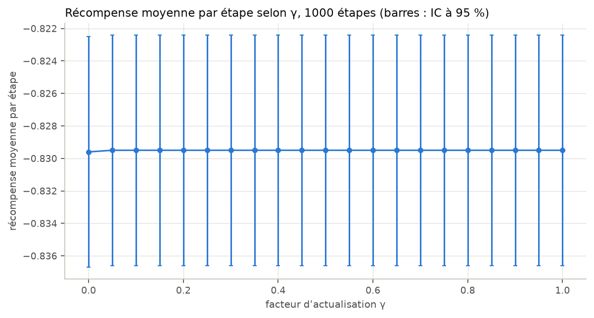

**Toutes les valeurs γ ∈ ]0, 1] sont ex aequo** : elles jouent exactement les mêmes
parties. Même l'écart apparié avec γ = 0, plus précis que la comparaison des moyennes,
n'est pas significatif (−0,13 ± 0,26 : l'intervalle contient 0). Sur 1000 étapes,
aucune valeur de γ n'est meilleure qu'une autre : l'agent n'a pas eu le temps de revoir
assez d'états pour que γ intervienne.

### Question 3.14 - Sur 10 000 étapes

*Travail collectif*

```python
def q14(pool, rows_1000=None):
    rows, best = sweep(pool, 10_000, N_RUNS_LONG)        # 500 relances de 10 000 étapes
    plot_sweep([("1000 étapes", rows_1000), ("10000 étapes", rows)], ...)
    compare_gammas(pool, 10_000, N_RUNS_LONG, 500, "ex3_q14_gammas_10000.png", ...)
```

`python ex3_qlearning.py q14` :

| γ | Récompense totale moyenne sur 10 000 étapes (IC 95 %) | Parties identiques à γ = 0,5 | Écart apparié avec γ = 0,5 |
|---|---|---|---|
| 0 | −8115,3 ± 29,9 | 379 / 500 | −0,92 ± 12,40 |
| 0,05 à 1 (20 valeurs) | −8114,4 ± 30,0 | 500 / 500 | 0 (parties identiques) |
| aléatoire (ε = 1) | −9074,0 ± 39,5 | - | - |

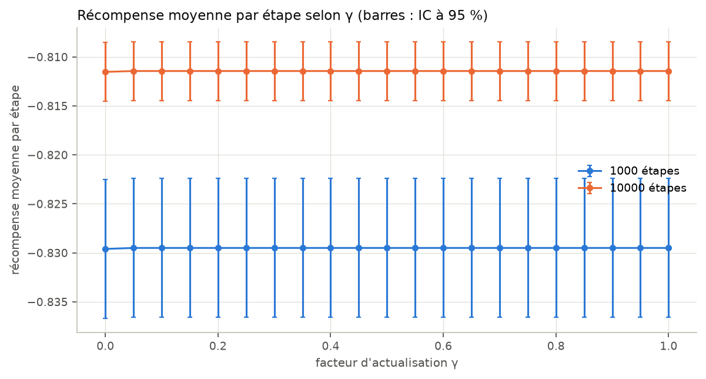

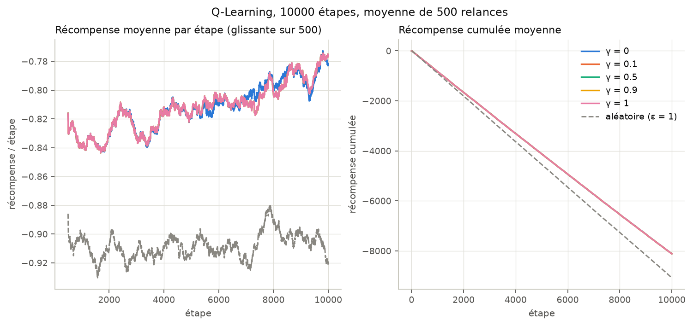

**La meilleure valeur n'a pas changé** : toutes les valeurs γ > 0 restent ex aequo et
produisent les mêmes parties. γ = 0 se sépare un peu plus (121 parties sur 500
diffèrent), mais l'écart apparié (−0,92 ± 12,40 sur 10 000 étapes) n'est toujours pas
significatif. L'apprentissage devient en revanche visible : la récompense
par étape passe d'environ −0,83 à −0,78, alors que le joueur aléatoire reste vers −0,91.

### Pour aller plus loin - entraînements de 1 000 000 d'étapes

*Travail collectif*

Pour savoir quand γ commence à compter, nous avons prolongé l'entraînement à un million
d'étapes (32 relances par valeur de γ, `python ex3_qlearning.py long`).

```python
LONG_STEPS = 1_000_000
LONG_GAMMAS = [0, 0.05, 0.1, 0.2, 0.3, 0.5, 0.7, 0.9, 1]


def long_horizon(pool):
    for gamma in LONG_GAMMAS:
        tasks = [(gamma, LONG_STEPS, seed, LONG_BLOCK) for seed in range(LONG_RUNS)]
        blocks = np.array(list(pool.map(_run_blocks, tasks)))   # (relances, blocs)
        ...
        mean_last, ci = mean_ci(blocks[:, -10:].mean(axis=1))      # 100 000 dernières étapes
        mean_total, ci_total = mean_ci(blocks.mean(axis=1))
        ...
    max_q = list(pool.map(_max_q, (0.5, 0.9, 1)))                 # croissance de |Q|
    ...   # tableau et graphique


def _max_q(gamma, seed=0):
    """max |Q| au fil d'une même partie (graine 0), à chaque point de MAX_Q_CHECKPOINTS."""
    game = ShortSnake(SIZE, seed=seed)
    player = GreedyPlayer(game, EPS, alpha=ALPHA, gamma=gamma, seed=1_000_000 + seed)
    done, values = 0, []
    for checkpoint in MAX_Q_CHECKPOINTS:
        play(player, game, checkpoint - done)
        done = checkpoint
        values.append(round(max(abs(v) for v in player.action_values.values()), 2))
    return [gamma, *values]
```

| γ | Récompense / étape sur 10⁶ étapes | Sur les 100 000 dernières étapes |
|---|---|---|
| 0 | −0,061 | 0,044 ± 0,002 |
| 0,05 | 0,559 | **0,948 ± 0,004** |
| 0,1 | 0,558 | **0,948 ± 0,003** |
| 0,2 | 0,558 | **0,948 ± 0,004** |
| 0,3 | 0,557 | **0,948 ± 0,003** |
| 0,5 | 0,552 | 0,938 ± 0,003 |
| 0,7 | 0,545 | 0,926 ± 0,004 |
| 0,9 | 0,524 | 0,877 ± 0,003 |
| 1 | 0,354 | 0,379 ± 0,016 |

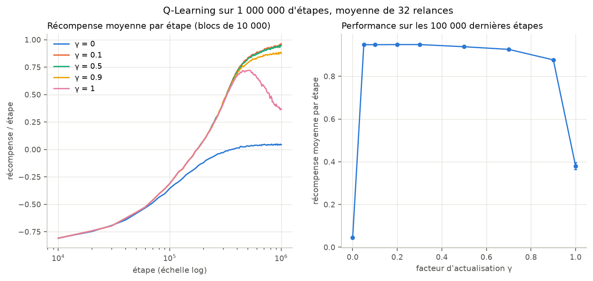

Sur un entraînement long, γ devient décisif :

- **γ = 0** plafonne à 0,04 par étape : l'agent ne voit que la récompense immédiate. Il
  évite les bords et mange le fruit quand il est juste devant lui, mais ne va pas le
  chercher.
- **γ ∈ [0,05 ; 0,3]** donne la meilleure performance : un gain net de 0,95 point par
  étape (fruits mangés moins bords franchis). Un petit γ suffit pour que les cases proches du fruit valent
  plus que les autres, d'autant plus que le fruit est proche (10·γ<sup>k</sup>). Au-delà
  du fruit, l'avenir est aléatoire (nouveau fruit) : le compter fortement ajoute
  surtout du bruit aux estimations.
- **γ = 1** monte jusqu'à 0,72 puis redescend à 0,38. Sans actualisation, manger le fruit
  dans 3 coups ou dans 10 coups rapporte autant : rien ne pousse l'agent à se dépêcher.
  La somme des récompenses n'est pas bornée non plus dans une tâche continue : le cours
  impose γ < 1 pour qu'elle converge. Les valeurs Q le montrent (`_max_q`,
  `resultats/ex3_max_q.csv`, une partie de graine 0) :

| γ | max \|Q\| à 10⁴ étapes | 10⁵ | 3·10⁵ | 10⁶ | Borne 10 / (1 − γ) |
|---|---|---|---|---|---|
| 0,5 | 7,5 | 11,2 | 12,8 | 13,4 | 20 |
| 0,9 | 7,5 | 12,7 | 16,7 | 24,7 | 100 |
| 1 | 7,5 | 13,4 | 19,9 | 31,5 | aucune |

  Pour γ < 1, |Q| ne peut pas dépasser 10 / (1 − γ). Avec γ = 0,5, il plafonne déjà à
  13,4. Avec γ = 1, rien ne le limite et il continue de croître. Nous avons mesuré deux
  faits : |Q| n'est pas borné, et la performance baisse après un pic à 0,72. Le lien
  entre les deux reste une hypothèse que nous n'avons pas vérifiée : sans actualisation,
  une valeur additionne toutes les récompenses futures et reflète surtout l'historique
  des mises à jour, plus que la distance au fruit.

La réponse aux questions 12 à 14 dépend donc de la durée d'entraînement : γ n'a pas
d'effet significatif sur 1000 et 10 000 étapes, et un petit γ (0,05 à 0,3) est le
meilleur une fois que l'agent a assez joué pour revoir les mêmes états.

---

## Exercice 4 - (Bonus) Snake plus long

Tout le code de l'exercice 4 est dans `snake.py` (paramètre `length`), `mdp.py`
(modèle et comptage) et `ex4_long_snake.py` (expériences). Le serpent ne grandit
toujours pas : sa longueur L est fixée à la création de la partie.

### Question 4.1 - État d'un serpent de 2 cases

*Travail collectif*

```python
    def save_state(self):
        """Renvoie l'état actuel du jeu : (tête, direction, fruit), plus le corps
        (tuple des cases, du cou à la queue) pour un serpent de longueur ≥ 2.
        ...
        """
        if self.body:
            return (self.snake_pos, self.snake_dir, self.fruit_pos, tuple(self.body))
        return (self.snake_pos, self.snake_dir, self.fruit_pos)
```

Pour un serpent de 2 cases, l'état contient :

- la **position de la tête** ;
- la **position de la seconde case** (le cou) ;
- la **position du fruit**.

La direction n'apporte plus d'information : le cou est toujours la case d'où vient la
tête, donc la direction se déduit de la tête et du cou, et inversement, dès que chaque
côté de la grille fait au moins 3 cases (sur un côté de 2, monter et descendre mènent
à la même case). Nous la
gardons dans le tuple parce que `actions(state)` la lit en `state[1]`, mais elle ne
multiplie pas le nombre d'états. Pour L ≥ 3, il faut toutes les cases du corps : leur
disposition dépend des derniers virages, et elle détermine les cases libres pour le
fruit et, à partir de 5 cases, les auto-intersections.

### Question 4.2 - Nombre d'états avec un serpent de 2 cases

*Travail collectif*

```python
def body_shapes(length):
    """Formes du serpent : directions des déplacements, de la tête vers la queue, sans
    demi-tour entre deux déplacements successifs. La première est la direction courante."""
    shapes = [(d,) for d in DIRECTIONS]
    for _ in range(length - 2):
        shapes = [s + (d,) for s in shapes for d in DIRECTIONS if d != OPPOSITE[s[-1]]]
    return shapes


def n_long_states(n_rows, n_cols, length):
    """|S| = N·M positions de tête × somme, sur les formes du corps, des cases libres
    pour le fruit (N·M − nombre de cases occupées par le serpent).

    Valable quand chaque côté de la grille fait au moins `length` cases (condition imposée
    par ShortSnake) : deux formes différentes donnent alors deux serpents différents."""
    n_cells = n_rows * n_cols
    head = (0, 0)   # le décompte ne dépend pas de la position de la tête (grille torique)
    return n_cells * sum(
        n_cells - len(set(snake_cells(head, shape, length, (n_rows, n_cols))))
        for shape in body_shapes(length)
    )
```

Pour un serpent de 2 cases : N·M positions de la tête, 4 directions (qui fixent le cou),
et N·M − 2 cases libres pour le fruit.

<p class="formula">|S| = 4 · N · M · (N · M − 2)</p>

**Pour une grille 10 × 10 : 4 × 100 × 98 = 39 200 états**, un peu moins que les 39 600
du serpent d'une case. La seconde case n'ajoute aucune information, puisqu'elle se
déduit de la direction, mais elle retire une case au fruit.

Le comptage est vérifié par le code (`python ex4_long_snake.py q2`). Le contrôle
indépendant est l'accessibilité : sur de petites grilles, un parcours en largeur du
modèle (lui-même vérifié contre le jeu par les tests) part de l'état initial et atteint
exactement les états comptés, ni plus ni moins (`resultats/ex4_accessibilite.csv`) :

| Grille | Longueur | États comptés (`n_long_states`) | États atteints depuis l'état initial |
|---|---|---|---|
| 4 × 4 | 2 | 896 | 896 |
| 5 × 5 | 2 | 2 300 | 2 300 |
| 4 × 4 | 3 | 2 496 | 2 496 |
| 4 × 5 | 4 | 11 520 | 11 520 |
| 5 × 5 | 5 | 54 200 | 54 200 |

Pour L = 2, les deux premières lignes valent bien 4 · 16 · 14 = 896 et 4 · 25 · 23 = 2 300.

### Question 4.3 - Serpent de 2 cases (et plus) dans `ShortSnake`

*Travail collectif*

```python
    def __init__(self, size=10, seed=None, length=1):
        ...
        if length < 1 or length >= self.n_rows * self.n_cols or (
                length > 1 and length > min(self.n_rows, self.n_cols)):
            raise ValueError("longueur du serpent incompatible avec la grille")
        self.length = length
        ...
        # corps : les cases derrière la tête, de la plus proche à la queue
        row, col = self.snake_pos
        self.body = deque((row, (col - i) % self.n_cols) for i in range(1, length))
        for cell in self.body:
            self._set_cell(cell, SNAKE)
        self.self_hits = 0   # nombre d'auto-intersections

    def move(self, direction=None):
        ...
        new_head = (row, col)
        if self.body:
            self.body.appendleft(self.snake_pos)   # l'ancienne tête devient le cou
            tail = self.body.pop()                 # la queue avance
            if tail not in self.body:              # case encore occupée si le corps se croise
                self._set_cell(tail, EMPTY)
            # auto-intersection : la tête entre dans son propre corps
            if new_head in self.body:
                reward += SELF_PENALTY
                self.self_hits += 1
        else:
            self._set_cell(self.snake_pos, EMPTY)
        self.snake_pos = new_head
        self._set_cell(self.snake_pos, SNAKE)
        ...
```

Nous avons directement implémenté une longueur L quelconque. Le corps est une file
(`deque`) : à chaque pas, l'ancienne tête devient le cou et la dernière case est
libérée. Pour L = 1, le code suit exactement le chemin des exercices 1 à 3. Les
résultats de l'exercice 3 sont identiques au chiffre près (−870 pour la partie de la
question 3.10).

`restore_state` vérifie en plus que le corps a la bonne longueur, que le cou est juste
derrière la tête, que chaque case du corps touche la suivante et que le corps ne
contient pas de demi-tour (`_check_body`) : seuls les états que le jeu peut produire
sont acceptés. Un serpent de L ≥ 2 cases ne peut pas être plus long que le petit côté de
la grille ; sinon, en ligne droite, il pourrait se recouvrir en passant le bord, et deux
corps différents pourraient occuper les mêmes cases. Le
modèle `long_transitions` de `mdp.py` généralise la dynamique de l'exercice 2. Comme
pour l'exercice 2, un test joue des coups au hasard depuis des états quelconques et
vérifie que le jeu donne toujours un résultat prévu par le modèle
(`tests/test_long_snake.py`, 18 tests).

`python ex4_long_snake.py demo` montre l'auto-intersection d'un serpent de 5 cases, qui
fait un carré et se mord la queue :

```text
État initial       move(DOWN) -> +0   move(LEFT) -> +0   move(UP) -> -10
+--------+         +--------+         +--------+         +--------+
|.......*|         |.......*|         |.......*|         |.......*|
|........|         |........|         |........|         |........|
|........|         |........|         |........|         |........|
|oooo>...|         |.oooo...|         |..ooo...|         |...^o...|
|........|         |....v...|         |...<o...|         |...oo...|
|........|         |........|         |........|         |........|
+--------+         +--------+         +--------+         +--------+
```

(Les grilles, affichées l'une sous l'autre par le programme, sont mises côte à côte
ici.)

### Question 4.4 - Modifications de `GreedyPlayer`

*Travail collectif*

```python
    def _greedy_action(self, state):                                    # greedy_player.py
        ...
        valeurs = [(action, self._value(state, action)) for action in actions(state)]
        ...


def actions(state):                                                     # mdp.py
    ...
    return _LEGAL_ACTIONS[state[1]]
```

**Aucune modification n'est nécessaire.** Le joueur ne lit l'état qu'à travers
`game.save_state()` et ne s'en sert que de deux façons : comme clé du dictionnaire Q,
ce qui marche pour n'importe quel tuple hachable, et pour obtenir les actions
possibles, qui ne dépendent que de la direction `state[1]`, placée au même endroit
quelle que soit la longueur. Le test
`test_player_with_long_snake` fait jouer le même `GreedyPlayer` avec un serpent de
5 cases : les clés du tableau Q sont bien des états à 4 éléments, et toutes les
actions apprises sont légales.

### Question 4.5 - Les graphiques de l'exercice 3 pour un serpent de 2 cases

*Travail collectif*

```python
def q5(pool):
    ex3.q10(pool, length=2, prefix="ex4")
    ex3.q11(pool, length=2, prefix="ex4")
    ex3.q12(pool, length=2, prefix="ex4")
    rows_1000 = ex3.q13(pool, length=2, prefix="ex4")
    ex3.q14(pool, rows_1000, length=2, prefix="ex4")
    ex3.long_horizon(pool, length=2, prefix="ex4")
```

Les fonctions de l'exercice 3 prennent un paramètre `length`. Les graphiques sont donc
produits par exactement le même code, avec les mêmes graines, les mêmes relances et les
mêmes hyperparamètres (ε = 0,1, α = 0,5). Seule la longueur du serpent change
(`python ex4_long_snake.py q5`, résultats dans `resultats/ex4_*.csv`).

<div class="fig-grid">
<figure>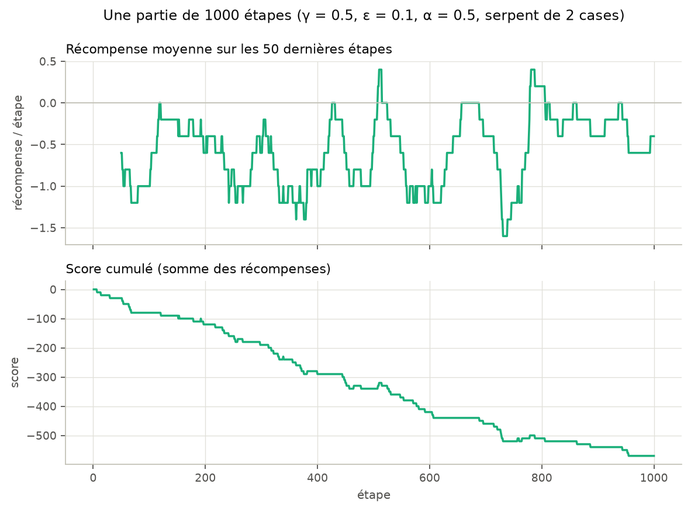<figcaption>Une partie de 1000 étapes (comme 3.10)</figcaption></figure>
<figure>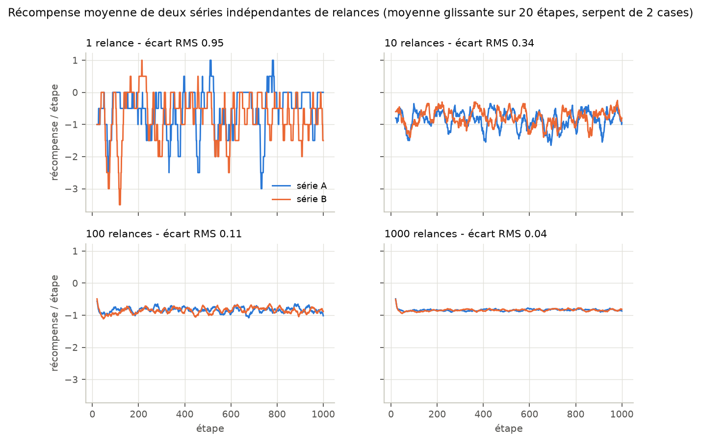<figcaption>Nombre de relances (comme 3.11)</figcaption></figure>
<figure>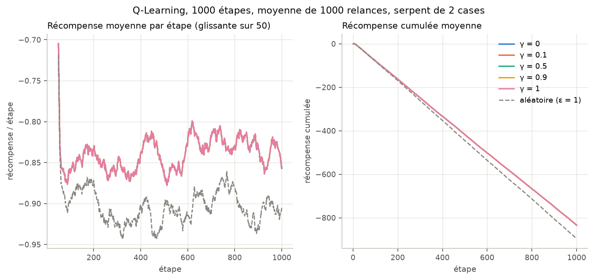<figcaption>Cinq valeurs de γ, 1000 étapes (comme 3.12)</figcaption></figure>
<figure>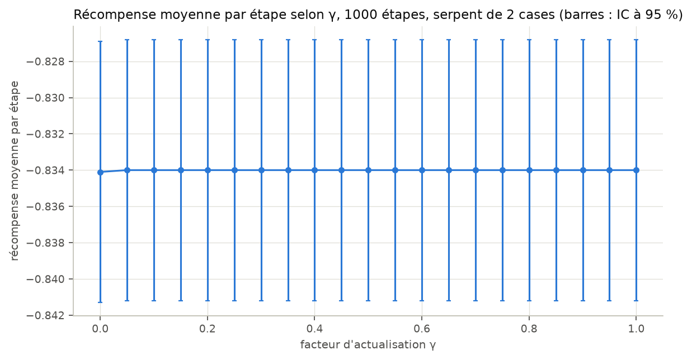<figcaption>Recherche de γ, 1000 étapes (comme 3.13)</figcaption></figure>
<figure>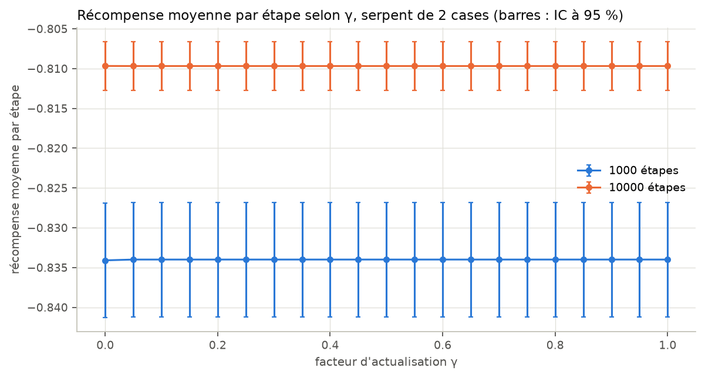<figcaption>Recherche de γ, 10 000 étapes (comme 3.14)</figcaption></figure>
<figure>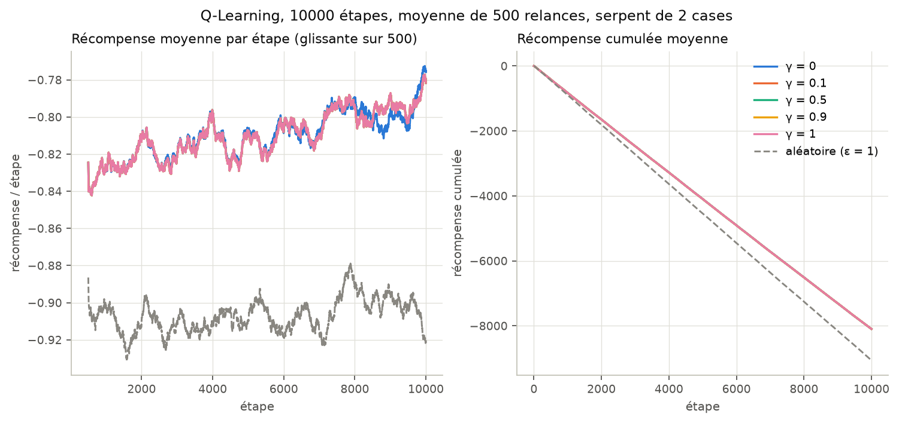<figcaption>Cinq valeurs de γ, 10 000 étapes (comme 3.14)</figcaption></figure>
</div>

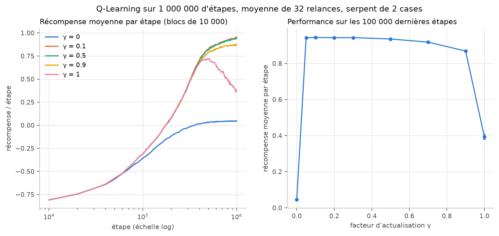

| Graphique | Serpent de 1 case (exercice 3) | Serpent de 2 cases |
|---|---|---|
| une partie de 1000 étapes (graine 0) | −870 | −570 |
| écart RMS entre deux séries de 1000 relances | 0,033 | 0,035 |
| 1000 étapes, γ > 0 (1000 relances) | −829,5 ± 7,1 | −834,0 ± 7,2 |
| 1000 étapes, écart apparié γ = 0 / γ = 0,5 | −0,13 ± 0,26 | −0,10 ± 0,15 |
| 1000 étapes, joueur aléatoire | −894,9 ± 7,9 | −895,8 ± 7,9 |
| 10 000 étapes, γ > 0 (500 relances) | −8114,4 ± 30,0 | −8096,8 ± 30,7 |
| 10 000 étapes, écart apparié γ = 0 / γ = 0,5 | −0,92 ± 12,40 | +0,10 ± 13,99 |
| 10⁶ étapes, meilleurs γ (100 000 dernières étapes) | 0,948 (γ de 0,05 à 0,3) | 0,942 à 0,944 (γ de 0,05 à 0,3) |
| 10⁶ étapes, γ = 0 | 0,044 | 0,045 |
| 10⁶ étapes, γ = 1 | 0,379 | 0,393 |

Les graphiques sont pratiquement les mêmes que pour un serpent d'une case, et les
conclusions de l'exercice 3 restent valables :

- **Une partie seule** reste dominée par le bruit (−570 contre −870 : simple variation
  d'une partie à l'autre).
- **1000 relances** suffisent toujours à superposer deux séries indépendantes.
- **Sur 1000 et 10 000 étapes**, toutes les valeurs γ > 0 jouent les mêmes parties, et
  γ = 0 ne s'en distingue pas significativement. Sur 10 000 étapes, γ = 0 a la meilleure
  moyenne, mais de 0,1 point seulement, avec un écart apparié de +0,10 ± 13,99.
- **Sur un million d'étapes**, les meilleurs γ sont encore entre 0,05 et 0,3. γ = 0
  plafonne, et γ = 1 monte puis redescend.

### Question 4.6 - Vitesse d'accroissement de la récompense : 1 case contre 2 cases

*Travail collectif*

```python
def q6(pool):
    ...
    n_runs = ex3.N_RUNS_LONG
    short = {length: ex3.run_many(pool, 0.5, 10_000, n_runs, length=length) for length in (1, 2)}
    rows, gains = [], {}
    for length, rewards in short.items():
        ...
        gains[length] = rewards[:, -1000:].mean(axis=1) - rewards[:, :1000].mean(axis=1)
        gain, ci_gain = mean_ci(gains[length])
        ...
    diff, ci_diff = mean_ci(gains[2] - gains[1])   # mêmes graines : écart apparié
    ...
    for length in (1, 2):
        for gamma in (0.1, 0.5):
            tasks = [(gamma, ex3.LONG_STEPS, seed, ex3.LONG_BLOCK, length)
                     for seed in range(ex3.LONG_RUNS)]
            blocks = np.array(list(pool.map(ex3._run_blocks, tasks)))
            curves[length, gamma] = blocks.mean(axis=0)
            last, ci_last = mean_ci(blocks[:, -10:].mean(axis=1))
            zero = first_step_above(curves[length, gamma], ex3.LONG_BLOCK, 0)
            half = first_step_above(curves[length, gamma], ex3.LONG_BLOCK, 0.5)
            ...


def first_step_above(curve, block, threshold):
    """Première étape (fin de bloc) où la récompense moyenne atteint `threshold`."""
    above = np.nonzero(curve >= threshold)[0]
    return int((above[0] + 1) * block) if len(above) else None
```

`python ex4_long_snake.py q6` (`resultats/ex4_q6_comparaison.csv`) :

| | 1 case | 2 cases |
|---|---|---|
| 10 000 étapes, γ = 0,5 : gain entre les 1000 premières et les 1000 dernières étapes | +0,044 ± 0,014 | +0,035 ± 0,014 |
| 10⁶ étapes : récompense ≥ 0 atteinte à l'étape (γ = 0,1 et 0,5) | 180 000 | 180 000 |
| 10⁶ étapes : récompense ≥ 0,5 atteinte à l'étape (γ = 0,1 et 0,5) | 330 000 | 330 000 |
| 10⁶ étapes, γ = 0,1 : 100 000 dernières étapes | 0,948 ± 0,003 | 0,944 ± 0,004 |
| 10⁶ étapes, γ = 0,5 : 100 000 dernières étapes | 0,938 ± 0,003 | 0,935 ± 0,004 |

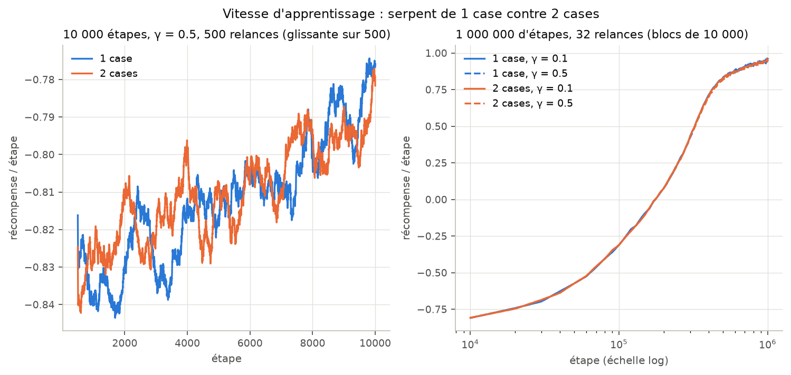

**La récompense croît à la même vitesse avec 1 ou 2 cases.** Les courbes sur un million
d'étapes sont superposées, et elles franchissent 0 puis 0,5 au même bloc de 10 000
étapes. Sur 10 000 étapes, les gains (+0,044 et +0,035) ne sont pas significativement
différents : leur écart, partie par partie, vaut −0,009 ± 0,018, et l'intervalle
contient 0.

C'est ce que prévoit la question 4.2 : l'état du serpent de 2 cases contient la même
information que celui du serpent d'une case, puisque le cou se déduit de la direction,
et il y a presque autant d'états (39 200 contre 39 600). La seule différence est que le
fruit ne peut pas apparaître sur le cou, ce qui ne change presque rien à
l'apprentissage.

### Question 4.7 - Serpents plus longs et entraînements plus longs

*Travail collectif*

```python
Q7_GAMMA = 0.1           # parmi les meilleures sur 1e6 étapes à l'exercice 3 (ex aequo de 0.05 à 0.3)
Q7_STEPS = 1_000_000
Q7_RUNS = 16
Q7_BLOCK = 10_000
Q7_LONG_LENGTHS = [1, 2, 3, 4]
Q7_LONG_STEPS = 5_000_000
Q7_LONG_RUNS = 8
Q7_LONG_BLOCK = 50_000
Q7_WORKERS = 16          # limite la mémoire : jusqu'à ~1 million de paires par partie


def _train(task):
    """Une partie ; renvoie la récompense moyenne et le taux d'auto-intersection par bloc."""
    length, n_steps, seed, block, eps = task
    game = ShortSnake(SIZE, seed=seed, length=length)
    player = GreedyPlayer(game, eps, alpha=ALPHA, gamma=Q7_GAMMA, seed=1_000_000 + seed)
    means, hits, previous = [], [], 0
    for _ in range(n_steps // block):
        means.append(ex3.play(player, game, block).mean())
        hits.append((game.self_hits - previous) / block)
        previous = game.self_hits
    return np.array(means), np.array(hits), len(player.action_values)
```

`python ex4_long_snake.py q7` entraîne des serpents de 1, 2, 3, 4, 5, 6 et 8 cases pendant
un million d'étapes (16 relances, γ = 0,1). Les serpents de 1 à 4 cases sont ensuite
entraînés cinq millions d'étapes (8 relances). Le joueur aléatoire (ε = 1) sert de
référence pour chaque longueur. Les résultats sont dans `resultats/ex4_q7_longueurs.csv`
et `resultats/ex4_q7_5M.csv`.

**Taille du problème** (`n_long_states`, grille 10 × 10, `resultats/ex4_etats.csv`) :

| Longueur | Formes du corps | États | Paires (état, action) |
|---|---|---|---|
| 1 | 4 | 39 600 | 118 800 |
| 2 | 4 | 39 200 | 117 600 |
| 3 | 12 | 116 400 | 349 200 |
| 4 | 36 | 345 600 | 1 036 800 |
| 5 | 108 | 1 026 800 | 3 080 400 |
| 6 | 324 | 3 050 400 | 9 151 200 |
| 8 | 2 916 | 26 937 600 | 80 812 800 |

Chaque case de plus multiplie le nombre de formes par 3 : 4 · 3<sup>L−2</sup> pour
L ≥ 2, car le corps ne peut pas faire demi-tour. Jusqu'à 4 cases, le corps ne se recoupe
jamais et |S| = 4 · 3<sup>L−2</sup> · N·M · (N·M − L). À partir de 5 cases, il peut
former une boucle de 4 cases ; c'est là qu'apparaissent les auto-intersections.

**Après un million d'étapes** :

| Longueur | Récompense / étape (100 000 dernières) | Joueur aléatoire | Auto-intersections (agent / aléatoire) | Récompense ≥ 0 à l'étape | Paires vues |
|---|---|---|---|---|---|
| 1 | +0,947 ± 0,005 | −0,912 | - | 180 000 | 92,8 % |
| 2 | +0,945 ± 0,006 | −0,912 | - | 180 000 | 93,4 % |
| 3 | +0,615 ± 0,006 | −0,913 | - | 470 000 | 84,6 % |
| 4 | −0,175 ± 0,006 | −0,910 | - | non atteint | 60,4 % |
| 5 | −1,191 ± 0,005 | −1,655 | 5,40 % / 7,44 % des étapes | non atteint | 28,2 % |
| 6 | −1,481 ± 0,008 | −1,654 | 6,64 % / 7,44 % | non atteint | 10,4 % |
| 8 | −2,045 ± 0,011 | −2,066 | 11,41 % / 11,55 % | non atteint | 1,2 % |

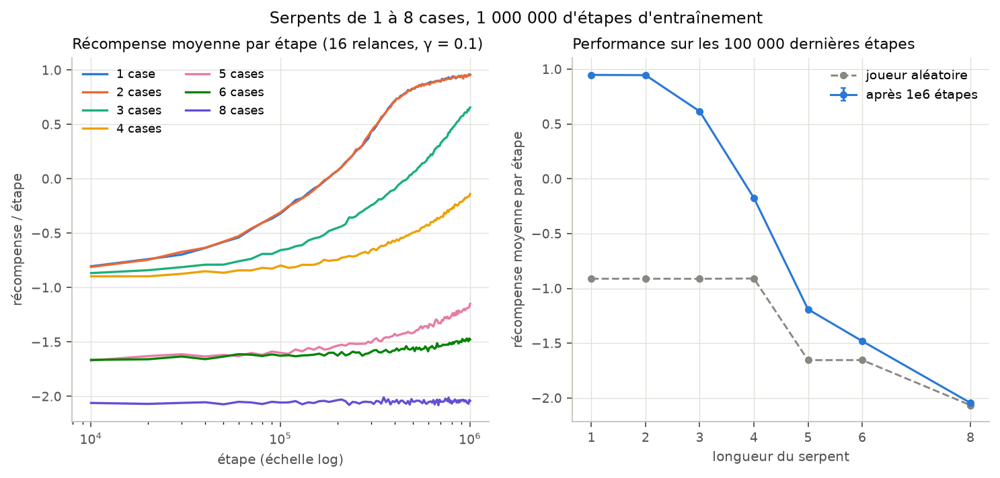

**Après cinq millions d'étapes** (serpents de 1 à 4 cases) :

| Longueur | Récompense / étape (100 000 dernières) | Récompense ≥ 0 à l'étape |
|---|---|---|
| 1 | +1,125 ± 0,004 | 200 000 |
| 2 | +1,116 ± 0,007 | 200 000 |
| 3 | +0,979 ± 0,006 | 500 000 |
| 4 | +0,803 ± 0,009 | 1 300 000 |

(Les étapes sont arrondies à la fin du bloc : 10 000 étapes sur un million d'étapes,
50 000 sur cinq millions.)

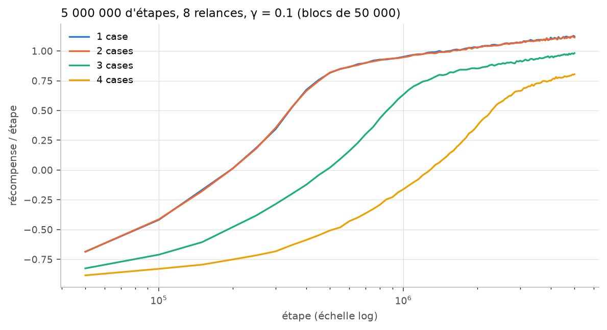

Ce que montrent ces résultats :

- **L'apprentissage ralentit avec la longueur, au rythme du nombre d'états.** Le
  Q-Learning tabulaire ne transfère rien d'une forme du corps à une autre : une même
  situation (tête, fruit) doit être réapprise pour chacune des 4 · 3<sup>L−2</sup>
  formes. Il faut environ 2,5 fois plus d'étapes à 3 cases (500 000 contre 200 000) et
  6,5 fois plus à 4 cases (1 300 000) pour atteindre une récompense positive. C'est du
  même ordre que la croissance du nombre d'états, ×3 puis ×9.
- **La part des paires (état, action) rencontrées s'effondre** : 93 % à 2 cases, 60 % à
  4 cases, 1,2 % à 8 cases, après le même million d'étapes. À 8 cases, l'agent ne
  revoit presque jamais un état et fait à peine mieux que le hasard : +0,02 point par
  étape (−2,045 ± 0,011 contre −2,066 ± 0,012).
- **Les auto-intersections apparaissent à partir de 5 cases.** Le joueur aléatoire se
  mord sur 7,4 % des étapes à 5 et 6 cases, et sur 11,6 % à 8 cases. L'agent descend à
  5,4 % à 5 cases. Cela explique un peu moins de la moitié de son avance sur le hasard :
  0,20 point par étape (10 × (7,44 % − 5,40 %)) sur 0,46 (−1,19 contre −1,66). Le reste
  vient des bords et des fruits.
- **Un entraînement plus long compense en partie.** À cinq millions d'étapes, le
  serpent de 4 cases atteint +0,80 par étape et celui de 3 cases +0,98, et les courbes
  montent encore. Même le serpent d'une case continue de progresser (+0,95 après un
  million d'étapes, +1,13 après cinq).

**Limite pratique.** 16 parties d'un million d'étapes en parallèle prennent 12 à 14 s, et
le tableau Q occupe environ 400 octets par paire. Les 16 parties en parallèle à 8 cases utilisent
ainsi environ 7 Go de mémoire. Explorer vraiment les 80,8 millions de paires d'un
serpent de 8 cases demanderait plus de 30 Go pour le seul tableau Q, au-delà des 31 Go
de la machine. Nous nous sommes donc arrêtés à 8 cases pour un million d'étapes, et à
4 cases pour cinq millions, où le tableau Q reste borné par le million de paires
possibles. Aller plus loin demanderait une représentation qui généralise d'un état à
l'autre, par exemple la position du fruit relative à la tête ou un réseau de neurones,
plutôt qu'un tableau.
